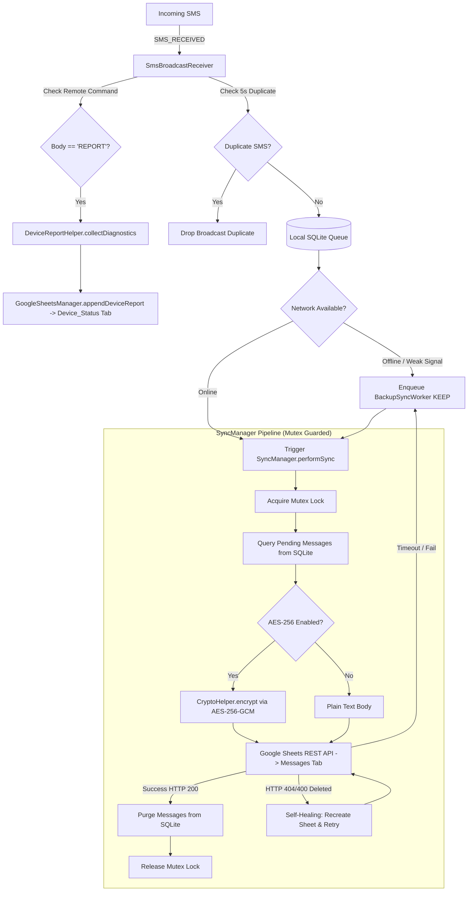

# Architecture & Module Reference — SuperApp (SMS Backup & Diagnostics)

## Project Root: `C:\Dev\Projects\msgforwarder`
## Package: `com.personal.msgforwarder`

---

## 1. What This App Does

**SuperApp** is a lightweight, privacy-first Android application designed for family caregivers and elderly support. It features two core utilities:
1. **SMS Backup**: Automatically synchronizes incoming SMS messages in real-time directly to a private Google Spreadsheet (`SUPERAPP_SHEET`) in the user's personal Google Drive account.
2. **Remote Device Diagnostics ("REPORT")**: Allows caregivers to remotely check phone vitals (battery, DND status, ringer mode & volume, screen brightness, Wi-Fi, cellular, Bluetooth, GPS) simply by sending an SMS with keyword `REPORT` to the device. The app compiles an instant snapshot and uploads it to a dedicated `Device_Status` tab in the user's spreadsheet.

### Key Capabilities:
- **Direct-to-Drive Sync (No Third-Party Servers)**: Communicates directly with Google Drive API v3 and Google Sheets API v4 using official Google OAuth 2.0 tokens (`https://www.googleapis.com/auth/drive.file` and `https://www.googleapis.com/auth/spreadsheets`).
- **Remote Diagnostics On-Demand**: Triggered automatically upon receiving an SMS containing `REPORT` (case-insensitive) or manually via the Repair screen. No persistent socket or battery drain required.
- **Zero Idle Battery Consumption**: Operates on an event-driven architecture with manifest-registered broadcast receivers. No persistent background services run while idle, keeping standby battery drain at 0%.
- **Client-Side AES-256-GCM Encryption**: Optional cryptographic layer enabling users to set a custom secret key passphrase. All SMS message content is encrypted with 256-bit AES-GCM before leaving the device. Date, time, and sender remain plain text for readability in the sheet.
- **Lightning-Fast Ingestion (<50ms)**: Incoming SMS messages are immediately written to a local SQLite database in under 20ms to guarantee zero message loss even if the device reboots, loses connectivity, or enters Android Doze mode.
- **Immediate Privacy Purge**: As soon as a message is confirmed uploaded to Google Sheets, it is immediately deleted from the local SQLite database. Messages never linger on the phone's storage.
- **Single-Flight Concurrency & Zero Duplication**: Centralized `SyncManager` protected by a coroutine `Mutex` prevents race conditions between immediate broadcast sync and background WorkManager jobs, guaranteeing zero duplicate uploads.
- **Self-Healing Google Sheets Integration**: If the spreadsheet or tab is accidentally deleted, moved, or corrupted in Google Drive (HTTP 404/400), the engine automatically detects the error, re-creates `SUPERAPP_SHEET` in Drive, formats columns, merges 100 cells horizontally with text-wrapping, styles headers in emerald green, and re-uploads pending messages without dropping data.
- **Doze & Offline Resilience**: Integrated with Android `WorkManager` for exponential backoff retries when offline, plus a built-in battery optimization whitelist flow.
- **Premium Dark Luxury Interface**: Minimalist OLED black (`#0A0B0D`) design, zero emojis, punch-hole camera safe insets, and a left-sliding navigation drawer displaying developer credits and security settings.
- **Ultra-Compact APK Size**: Optimized via R8 compiler tree-shaking, dead code elimination, and resource shrinking (~3.5–4.5 MB release build).

---

## 2. End-to-End Data Flow

---

## 3. Module & File Breakdown

### 3.1 Project Scaffolding & Configuration

| File | Path | Description & Purpose |
|---|---|---|
| `build.gradle.kts` (root) | `/build.gradle.kts` | Root Gradle build configuration; defines Kotlin and Android application plugins. |
| `settings.gradle.kts` | `/settings.gradle.kts` | Declares project name and sets up plugin/dependency repositories (Google, MavenCentral). |
| `app/build.gradle.kts` | `/app/build.gradle.kts` | App-level Gradle build file. Configures compileSdk 35, minSdk 26, Jetpack Compose BOM, Google Play Services Auth, OkHttp 4, WorkManager, R8 minification (`isMinifyEnabled = true`, `isShrinkResources = true`), and debug keystore signing. |
| `app/proguard-rules.pro` | `/app/proguard-rules.pro` | Custom R8/ProGuard rules preserving reflection constructors for WorkManager workers, OkHttp internal components, and Google Play Services Auth models. |
| `app/debug.keystore` | `/app/debug.keystore` | Bundled debug keystore ensuring deterministic SHA-1 (`94:D9:C2:FD:B0:5A:EF:0D:69:20:04:2B:06:5E:9D:10:E2:64:93:90`) across all developer workstations and GitHub Actions CI. |
| `AndroidManifest.xml` | `/app/src/main/AndroidManifest.xml` | Declares application permissions (`RECEIVE_SMS`, `READ_SMS`, `INTERNET`, `ACCESS_NETWORK_STATE`, `ACCESS_WIFI_STATE`, `BLUETOOTH`, `POST_NOTIFICATIONS`, `RECEIVE_BOOT_COMPLETED`, `REQUEST_IGNORE_BATTERY_OPTIMIZATIONS`), registers `SmsBroadcastReceiver` with high priority 999, and registers `BootReceiver`. |
| `.github/workflows/build.yml` | `/.github/workflows/build.yml` | GitHub Actions CI/CD workflow triggering on pushes to `main` and `superapp`. Builds `assembleRelease` with JDK 17 and Gradle 8.9, producing optimized APK releases. |

---

### 3.2 Synchronization & Data Layer (`data`, `sync`)

| File | Path | Description & Purpose |
|---|---|---|
| **`SyncManager.kt`** | `.../sync/SyncManager.kt` | Thread-safe single-flight synchronization gateway protected by Kotlin coroutine `Mutex`. Handles atomic queue retrieval, Google Sheets upload, and batch SQLite deletion, guaranteeing zero duplicate uploads between real-time receiver and WorkManager. |
| **`MessageData.kt`** | `.../data/MessageData.kt` | Data class representing an SMS item: `id: Long`, `sender: String`, `body: String`, `timestamp: Long`, `isSynced: Boolean`, `syncedAt: Long?`. |
| **`PreferencesHelper.kt`** | `.../data/PreferencesHelper.kt` | Thread-safe `SharedPreferences` wrapper. Manages local persistence for: Google account email and display name, active spreadsheet ID, sheet tab ID & URL, last sync timestamp, last report timestamp, backup enabled state, AES-256 encryption state (`isEncryptionEnabled`), and secret passphrase (`encryptionKey`). Zero network or battery overhead. |
| **`MessageDbHelper.kt`** | `.../data/local/MessageDbHelper.kt` | SQLite database helper managing table `messages`. Provides atomic transactions: synchronous insertion (`insertMessage`), 5-second duplicate broadcast detection (`isRecentDuplicate`), retrieval of unsynced messages (`getPendingMessages`), marking messages synced, and instant row deletion (`deleteBatch`) upon upload confirmation. |
| **`GoogleAuthManager.kt`** | `.../data/google/GoogleAuthManager.kt` | Handles Google Sign-In and OAuth 2.0 lifecycle. Requests drive/sheet scopes, parses sign-in results, and retrieves fresh bearer tokens via `GoogleAuthUtil.getToken()`. Features self-healing auth notifications when user re-consent is required (`UserRecoverableAuthException`). |
| **`GoogleSheetsManager.kt`** | `.../data/google/GoogleSheetsManager.kt` | REST API manager using OkHttp. Manages both tabs (`Messages` and `Device_Status`). Features OAuth token expiration recovery on HTTP 401, cached header validation, spreadsheet creation, header row styling, 100-cell horizontal merge (Columns D to CW) with text-wrapping, and batch row appends. |

---

### 3.3 Services & Background Workers (`receiver`, `worker`, `util`)

| File | Path | Description & Purpose |
|---|---|---|
| **`SmsBroadcastReceiver.kt`** | `.../receiver/SmsBroadcastReceiver.kt` | Manifest-registered receiver for `SMS_RECEIVED` (priority 999). Intercepts `REPORT` command to generate and upload remote diagnostics; saves SMS to SQLite (<20ms); triggers `SyncManager.performSync()` capped at a 10s timeout. Hands off to WorkManager if offline or timed out. |
| **`BootReceiver.kt`** | `.../receiver/BootReceiver.kt` | Manifest-registered receiver for `BOOT_COMPLETED`. Fires on device restart to verify if unsynced messages exist in SQLite; immediately enqueues `BackupSyncWorker` if needed. |
| **`BackupSyncWorker.kt`** | `.../worker/BackupSyncWorker.kt` | `CoroutineWorker` scheduled via WorkManager (`ExistingWorkPolicy.KEEP`). Delegates cleanly to `SyncManager.performSync()` to guarantee background delivery with exponential backoff retries without interrupting in-flight requests. |
| **`DeviceReportHelper.kt`** | `.../util/DeviceReportHelper.kt` | Gathers hardware and OS vitals: battery percentage & charging status, sound & ringer mode, Do Not Disturb (DND) status, screen brightness, Wi-Fi, cellular data, airplane mode, Bluetooth, and GPS location. |
| **`CryptoHelper.kt`** | `.../util/CryptoHelper.kt` | Native Android cryptographic utility (`javax.crypto`). Implements authenticated **AES-256-GCM** encryption with PBKDF2/SHA-256 key derivation (256-bit key) and cryptographically secure 12-byte random IVs per message. Prepends `ENC:` prefix to generated base64 payloads. |
| **`NotificationHelper.kt`** | `.../util/NotificationHelper.kt` | Creates and manages Android notification channels (`sms_backup_channel`, `auth_recovery_channel`). Builds high-priority actionable notifications for Google OAuth recovery, permission alerts, and sync status. |

---

### 3.4 UI Layer (`com.personal.msgforwarder.ui`)

| File | Path | Description & Purpose |
|---|---|---|
| **`MainActivity.kt`** | `.../MainActivity.kt` | Single activity host. Configures dark system theme, requests runtime SMS and notification permissions, and sets Compose content to `AppTheme { AppNavigation() }`. |
| **`SmsBackupScreen.kt`** | `.../ui/screens/SmsBackupScreen.kt` | SMS Backup component screen. Features real-time backup toggle switch, Google account status card (connected account email, Google Sheet link button, last synced relative time), and battery optimization warning banner with one-tap whitelist intent. Uses `.statusBarsPadding()` and scrollable container for compatibility across device sizes. |
| **`AppDrawer.kt`** | `.../ui/components/AppDrawer.kt` | Left-sliding navigation drawer (`ModalNavigationDrawer`). Houses "SuperApp" branding, component links (SMS Backup, Repair, Setting), and developer credits ("Created by SHIVAM GUPTA") pinned at bottom. |
| **`AppNavigation.kt`** | `.../ui/AppNavigation.kt` | Root SuperApp navigation container hosting `ModalNavigationDrawer`, state routing (`AppScreen`), and dynamic component switching. |
| **`RepairScreen.kt`** | `.../ui/screens/RepairScreen.kt` | Repair and diagnostics component. Houses Remote Device Report card (SMS 'REPORT' command explanation, live vitals snapshot, and manual test button), cloud sheet verification & self-healing, pending local queue flush, and battery whitelist health. |
| **`SettingsScreen.kt`** | `.../ui/screens/SettingsScreen.kt` | SuperApp settings component. Manages connected Google account, auto-sync preferences, client-side AES-256-GCM encryption toggle with secret key management dialog, and system metadata. |
| **`Color.kt`** | `.../ui/theme/Color.kt` | Premium dark luxury palette: `DeepBlack` (`#0A0B0D`), `SurfaceDark` (`#121418`), `SurfaceElevated` (`#181B20`), `BorderSubtle` (`#22262E`), `AccentEmerald` (`#10B981`), `AccentAmber`, and typography tones. |
| **`Theme.kt`** | `.../ui/theme/Theme.kt` | Material3 dark color scheme mapping typography and surfaces to modern AMOLED aesthetics. |

---

## 4. Google Sheet Structure

All data is organized within the user's `SUPERAPP_SHEET` spreadsheet across two specialized tabs:

### Tab 1: `Messages` (SMS Log)
| Column | Header | Width | Formatting | Content |
|---|---|---|---|---|
| **A** | Date | 110 px | Center aligned, Middle | `dd-MM-yyyy` (e.g. `23-10-2026`) |
| **B** | Time | 120 px | Center aligned, Middle | `hh:mm:ss a` (e.g. `11:45:12 PM`) |
| **C** | Sender | 140 px | Center aligned, Middle | Originating address / sender name |
| **D to CW** | Message Content | 100 merged cells | Left aligned, Top, Text Wrap (`WRAP`) | Plain text or `ENC:<Base64>` AES-256 payload |

### Tab 2: `Device_Status` (Remote Hardware Diagnostics)
| Column | Header | Width | Formatting | Content |
|---|---|---|---|---|
| **A** | Date & Time | 170 px | Center aligned, Middle | `dd-MM-yyyy hh:mm:ss a` |
| **B** | Battery | 140 px | Center aligned, Middle | Level % and state (e.g. `85% (Charging)`) |
| **C** | Sound / Ringer | 190 px | Center aligned, Middle | Ringer mode & volume (e.g. `Mode: NORMAL (Vol: 5/7)`) |
| **D** | DND Mode | 150 px | Center aligned, Middle | Interruption status (e.g. `OFF`, `ON (Total Silence)`) |
| **E** | Brightness | 130 px | Center aligned, Middle | Screen brightness % and mode (e.g. `65% (Adaptive)`) |
| **F** | Wi-Fi | 120 px | Center aligned, Middle | Status (`Connected` or `Disconnected`) |
| **G** | Mobile Data | 150 px | Center aligned, Middle | Status (`Active (Cellular)` or `Disconnected`) |
| **H** | Airplane Mode | 130 px | Center aligned, Middle | Status (`OFF` or `ACTIVE`) |
| **I** | Bluetooth | 110 px | Center aligned, Middle | Status (`Enabled` or `Disabled`) |
| **J** | GPS Location | 110 px | Center aligned, Middle | Status (`Enabled` or `Disabled`) |

---

## 5. Security & Privacy Highlights

1. **Direct Communication**: Data travels encrypted over TLS directly from the phone to Google's official REST endpoints (`https://sheets.googleapis.com` and `https://www.googleapis.com/drive`). No intermediary proxy, relay, or developer server ever sees or stores the data.
2. **Zero Local Storage Footprint**: Messages stored in local SQLite exist only while awaiting upload confirmation. The moment HTTP 200 OK is returned, the local row is purged.
3. **End-to-End Encryption (E2EE)**: When AES-256 encryption is toggled on, message contents cannot be read in Google Sheets without knowledge of the user's secret key.
4. **Scoped Permissions**: The OAuth 2.0 token requests only `drive.file` (access exclusively to files created by this app) and `spreadsheets`, avoiding broad access to the user's entire Google Drive.
